I build software that replaces manual back-office work: accounting, document processing, data.

I run a fleet of coding agents. They write most of the code. I design it, review it, and own what ships.

<picture>
  <source media="(prefers-color-scheme: dark)" srcset="card/ship-dark.svg">
  
</picture>

Counted from the GitHub API. The repos are private, so you get the numbers and not the code.

### Building

**[DebitBG](https://debitbg.com)** Accounting platform for Bulgarian firms. Invoices book themselves, the accountant approves.

**[Doculent](https://doculent.io)** Document extraction for insurance, healthcare and freight. 200 docs/min with human review.

**Databyte** Analytics platform and API layer for structured business data.

**Reclone.me** Executive agents that operate the way you do.

Earlier: Dustly, token-dusting ads on Solana explorers. Roo Trade, high-speed Solana trading.

### How it ships

- Every production bug gets a failing test before the fix.
- Every deploy is health-checked and rolls itself back on failure.
- Every migration stays compatible with the previous build.

<samp>TypeScript . Python . Postgres . Fastify . FastAPI . React . Next.js . Docker . AWS . Claude</samp>
